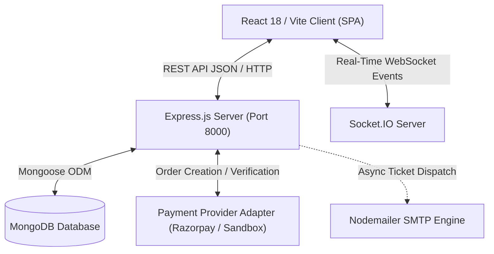

# IMovies Architecture Specification

## 1. System Overview

IMovies is an enterprise-grade full-stack cinema ticket booking web application built on the **MERN** stack (MongoDB, Express.js, React.js, Node.js) with real-time seat synchronization via Socket.IO.

## 2. Client-Server Architecture

### A. Frontend / Client Layer (`client/`)
- **Runtime & Bundler:** Vite with React.js (JavaScript JSX)
- **Routing:** React Router DOM (v7) supporting nested layouts, public routes, `ProtectedRoute`, and `AdminRoute`.
- **State Management:** React Context API:
  - `AuthContext`: Centralized session persistence, JWT token storage, customer vs. admin authorization.
  - `BookingContext`: Live seat selection state, countdown timers, price recalculation.
  - `ThemeContext`: Persisted dark/light cinematic theme switching.
- **Styling:** Vanilla CSS with custom design tokens (`theme.css`, `global.css`) and Bootstrap 5 utilities.
- **Real-Time Client:** `socket.io-client` syncing seat lock and release events across simultaneous browser sessions.
- **E-Tickets:** `qrcode.react` generating digital ticket QR codes with cryptographic verification links.

### B. Backend / Server Layer (`server/`)
- **Pattern:** Model-View-Controller (MVC) + Service Layer Architecture:
  - **Models (`models/`):** Strongly-typed Mongoose schemas with compound indexes, TTL eviction, and hooks.
  - **Controllers (`controllers/`):** Request extraction, validation dispatch, and standard HTTP response formatting.
  - **Services (`services/`):** Concurrency-safe seat locking, price calculation, idempotency checks, and payment signature verification.
  - **Middleware (`middleware/`):** Centralized JWT authentication, role verification, rate limiting, request validation, and error normalization.
  - **Routes (`routes/`):** Structured RESTful routing under `/api/v1`.

### C. Database Layer (`MongoDB`)
- Mongoose ODM connecting to local MongoDB (`mongodb://127.0.0.1:27017/imovies`), MongoDB Atlas, or an automated zero-config development `MongoMemoryServer` engine.

## 3. Concurrency-Safe Seat Locking Architecture

To prevent race conditions and double bookings:
1. Seat availability is associated strictly per show rather than as a static screen configuration.
2. When a customer selects seats and requests a hold:
   - Validates that the requested seats exist in the show's screen layout.
   - Verifies seats are not already booked in any `CONFIRMED` booking.
   - Verifies no active, unexpired `SeatLock` exists for these seats by another user.
   - Atomically creates an expiring `SeatLock` document with a 5-minute TTL.
   - Broadcasts `seat_locked` via Socket.IO to all users viewing the auditorium seat map.
3. If payment succeeds, booking confirmation permanently converts the locked seats into confirmed tickets and emits `seats_booked`.
4. If payment fails or times out, the lock expires or is released, emitting `seat_released`.
